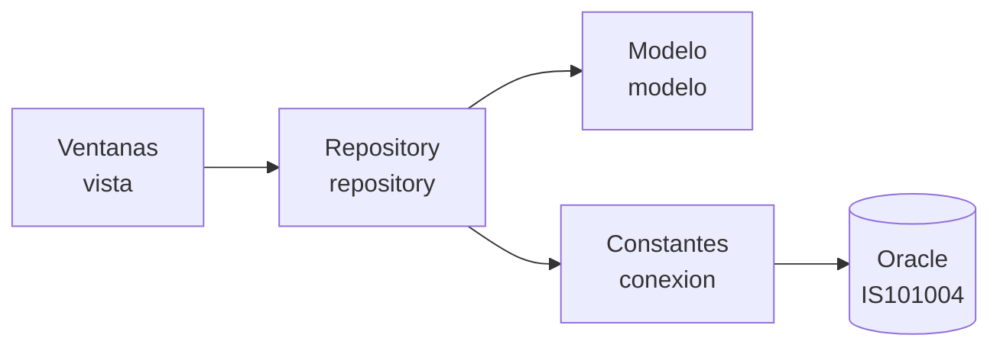
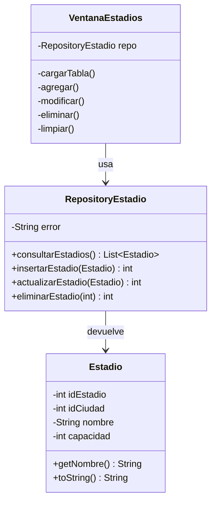
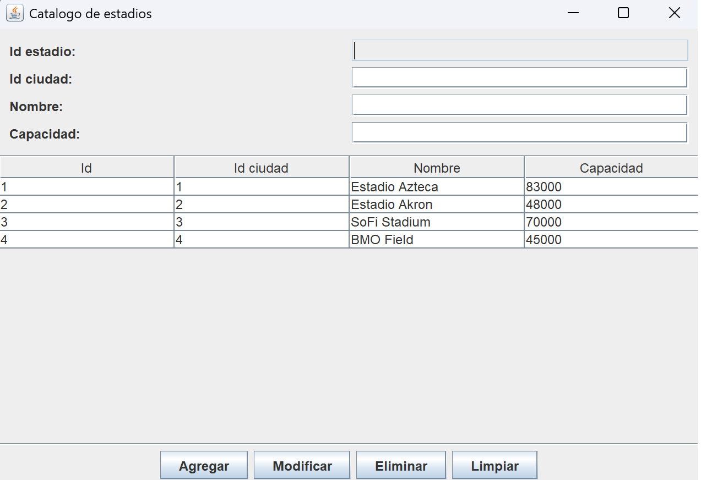
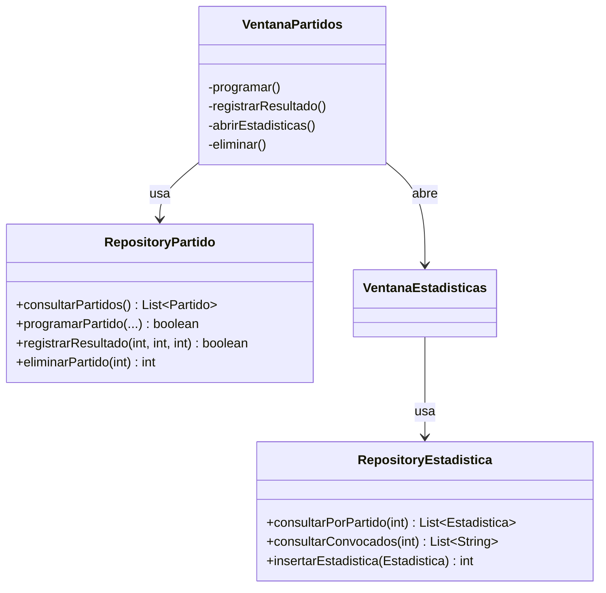

Arquitectura de la aplicacion

La aplicacion esta hecha en Java con Swing y usa Maven para el driver de Oracle (ojdbc11). Se conecta a la base del proyecto con JDBC, como lo vimos en clase. El codigo esta en app/mundial.

Usamos Swing porque ya viene con Java y para lo que necesitamos (ventanas con tablas y botones) es suficiente.

1. Como esta organizada

Seguimos el patron DAO que vimos en la clase de JDBC, separando las ventanas de las consultas a la base. Quedaron estos paquetes:

- conexion: la clase Constantes con THINCONN, USERNAME y PASSWORD. La clave se lee del archivo config.properties para no dejarla escrita en el codigo.
- modelo: una clase por tabla con sus atributos, constructor, getters y setters (Estadio, Jugador, Partido, etc.). Tambien hay clases para las filas de las consultas (Posicion, Resultado, Incidencia).
- repository: una clase por tabla con los select, insert, update y delete (RepositoryEstadio, RepositoryJugador, etc.), mas RepositoryConsultas y RepositoryReportes.
- vista: las ventanas. VentanaPrincipal tiene el menu y desde ahi se abre todo lo demas.

La ventana nunca hace SQL directamente, le pide los datos al repository y el repository es el que se conecta a la base.

2. Conexion con la base

Cada metodo del repository abre la conexion con DriverManager.getConnection usando los datos de Constantes. Todo va dentro de un try con recursos para que la conexion, el PreparedStatement y el ResultSet se cierren solos.

Usamos PreparedStatement con ? en todas las consultas para evitar inyeccion SQL. Los select se hacen con executeQuery y se recorren con while (rs.next()), y los insert, update y delete con executeUpdate.

Si la base devuelve un error, el repository lo atrapa y guarda el mensaje, y la ventana lo muestra. Por ejemplo, si se mete un estadio con capacidad 200000 sale el error del CHECK de la tabla, y si se ponen goles negativos en una estadistica sale el error del trigger trg_validar_rangos.

Para los ids nuevos usamos (select nvl(max(id), 0) + 1 from tabla) dentro del mismo insert, igual que en los triggers.

Cuando un campo puede ser null (por ejemplo el grupo de una seleccion o el minuto de salida de un jugador) se lee con rs.wasNull() y se guarda con ps.setNull().

3. Catalogos

Son 7: ediciones, ciudades sede, estadios, selecciones, grupos, jugadores y cuerpo tecnico. Todos tienen la misma estructura: una clase en modelo, un repository y una ventana con el formulario arriba, la tabla en el medio y los botones Agregar, Modificar, Eliminar y Limpiar abajo. Al hacer clic en una fila se llenan los campos para modificar o eliminar.

Donde la tabla tiene un CHECK con valores fijos (la posicion del jugador y el rol del cuerpo tecnico) usamos una lista desplegable con esos mismos valores, para que no se pueda escribir uno que no exista.

Este es el diagrama de clases del catalogo de estadios, los demas son iguales:

4. Partidos y estadisticas

En la ventana de partidos se ven todos los partidos con las dos selecciones y el marcador, y desde ahi se puede:

- Programar un partido: se guarda el partido y sus dos participaciones (local y visitante). Esto se hace como una transaccion con setAutoCommit(false), commit() y rollback(), asi si algo falla no queda un partido a medias. Por ejemplo, si se pone la misma seleccion de local y visitante el trigger trg_participacion_duplicada lanza el error -20004 y el rollback deshace tambien el partido.
- Registrar el resultado: se llama al procedimiento pr_registrar_resultado con un CallableStatement ({call pr_registrar_resultado(?, ?, ?)}). Como el procedimiento maneja sus errores con DBMS_OUTPUT y no los manda a Java, despues de llamarlo se revisa si el partido quedo FINALIZADO.
- Ver y cargar las estadisticas de cada jugador en ese partido (minutos, goles, asistencias y tarjetas). La lista de jugadores solo muestra los convocados de las dos selecciones del partido.

5. Consultas y reportes

Las consultas (tabla de posiciones, resultados consolidados e incidencias) estan en RepositoryConsultas y cada una tiene su ventana.

Los reportes estan en RepositoryReportes y se ven en una sola ventana con filtros por fase, grupo y seleccion. El where se arma con un StringBuilder agregando solo los filtros que el usuario escogio, cada uno con su ?. El detalle esta en docs/entrega3/reportes.md.

6. Resumen del menu

- Catalogos: ediciones, ciudades sede, estadios, selecciones, grupos, jugadores y cuerpo tecnico
- Partidos: programar, registrar resultado y estadisticas
- Consultas: tabla de posiciones, resultados consolidados e incidencias
- Reportes: panel con filtros
