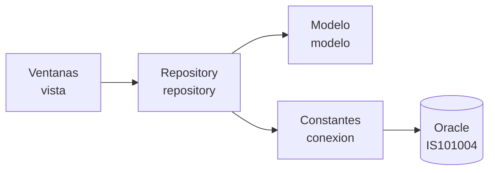
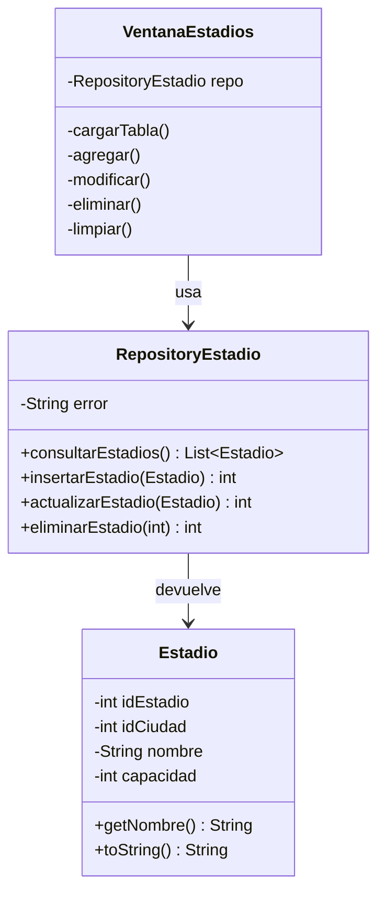

Arquitectura de la aplicacion

La aplicacion esta hecha en Java con Swing y usa Maven para el driver de Oracle (ojdbc11). Se conecta a la base del proyecto con JDBC, como lo vimos en clase. El codigo esta en app/mundial.

Usamos Swing porque ya viene con Java y para lo que necesitamos (ventanas con tablas y botones) es suficiente.

1. Como esta organizada

Seguimos el patron DAO que vimos en la clase de JDBC, separando las ventanas de las consultas a la base. Quedaron estos paquetes:

- conexion: la clase Constantes con THINCONN, USERNAME y PASSWORD. La clave se lee del archivo config.properties para no dejarla escrita en el codigo.
- modelo: una clase por tabla con sus atributos, constructor, getters y setters. Por ahora esta Estadio.
- repository: una clase por tabla con los select, insert, update y delete. Por ahora esta RepositoryEstadio.
- vista: las ventanas. VentanaPrincipal tiene el menu y desde ahi se abre cada catalogo.

La ventana nunca hace SQL directamente, le pide los datos al repository y el repository es el que se conecta a la base.

2. Conexion con la base

Cada metodo del repository abre la conexion con DriverManager.getConnection usando los datos de Constantes. Todo va dentro de un try con recursos para que la conexion, el PreparedStatement y el ResultSet se cierren solos.

Usamos PreparedStatement con ? en todas las consultas para evitar inyeccion SQL. Los select se hacen con executeQuery y se recorren con while (rs.next()), y los insert, update y delete con executeUpdate.

Si la base devuelve un error, el repository lo atrapa y guarda el mensaje, y la ventana lo muestra. Por ejemplo, si se mete un estadio con capacidad 200000 sale el error del CHECK de la tabla.

Para los ids nuevos usamos (select nvl(max(id), 0) + 1 from tabla) dentro del mismo insert, igual que en los triggers.

3. Catalogo de estadios

Es el primer catalogo y los demas se hacen igual. La ventana tiene el formulario arriba, la tabla en el medio y los botones Agregar, Modificar, Eliminar y Limpiar abajo. Al hacer clic en una fila se llenan los campos para modificar o eliminar.

4. Lo que falta

Ya estan hechos los catalogos de estadios, selecciones, grupos, jugadores y cuerpo tecnico, todos con la misma estructura. Faltan ediciones y ciudades sede. En la semana 3 van el registro de partidos y estadisticas usando pr_registrar_resultado, las consultas y los reportes.