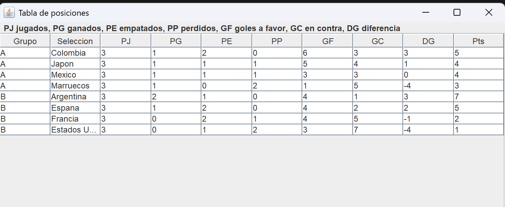
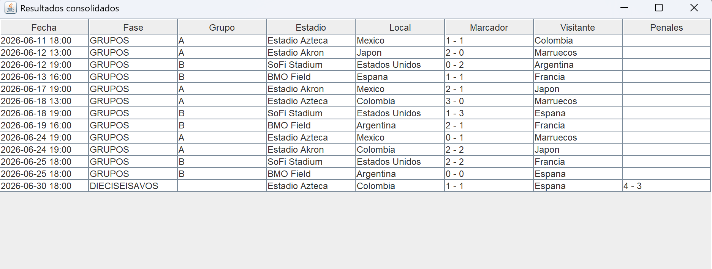
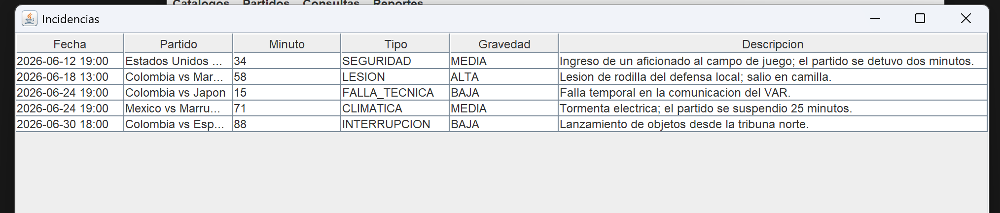
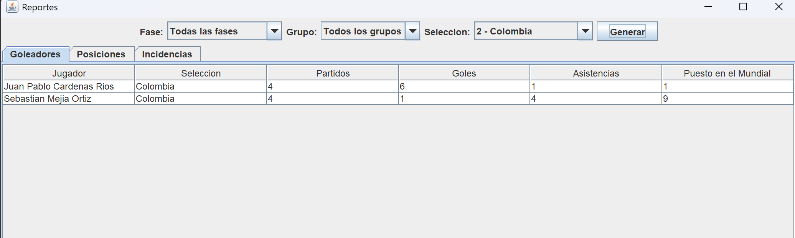
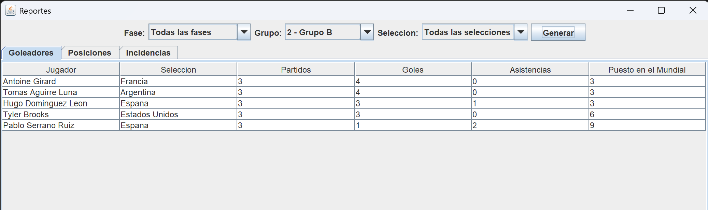

Reportes - Entrega 3

En este documento explicamos los reportes y consultas de la aplicacion. Todos leen los datos directamente de la base con JDBC y solo tienen en cuenta los partidos que estan FINALIZADO.

1. Consultas

Estan en el menu Consultas de la ventana principal. Muestran toda la informacion sin filtros.

# Tabla de posiciones

Muestra cada grupo con sus selecciones ordenadas por puntos, diferencia de gol y goles a favor. Para cada seleccion salen los partidos jugados (PJ), ganados (PG), empatados (PE), perdidos (PP), goles a favor (GF), goles en contra (GC), diferencia (DG) y puntos.

Solo cuentan los partidos de la fase de grupos. Los goles en contra salen de la participacion del rival en el mismo partido, igual que en la funcion fn_diferencia_gol, y los puntos salen de G = 3, E = 1 y P = 0, igual que en fn_puntos_seleccion.

# Resultados consolidados

Muestra todos los partidos que ya se jugaron con la fecha, la fase, el grupo, el estadio, las dos selecciones, el marcador y los penales si el partido se definio asi (por ejemplo Colombia vs Espana en dieciseisavos, 1 - 1 y penales 4 - 3).

# Incidencias

Muestra las incidencias de la tabla INCIDENCIA (lesiones, interrupciones, seguridad, fallas tecnicas, clima) con el partido, el minuto, el tipo, la gravedad y la descripcion.

2. Panel de reportes

Esta en el menu Reportes. Arriba tiene tres listas para filtrar y el boton Generar:

- Fase: todas o una fase (GRUPOS, DIECISEISAVOS, etc.)
- Grupo: todos o un grupo (A, B)
- Seleccion: todas o una seleccion

Los filtros se pueden combinar. Si se deja "Todas" ese filtro no se usa.

Abajo hay tres pestanas, una por reporte, y una linea de indicadores.

# Goleadores

Para cada jugador muestra la seleccion, los partidos que jugo, los goles y las asistencias en los partidos que cumplen los filtros. Solo salen los que tienen al menos un gol, ordenados por goles y despues por asistencias.

La ultima columna, Puesto en el Mundial, usa la funcion fn_puesto_goleador, entonces muestra el puesto del jugador en todo el Mundial aunque se este filtrando por un grupo o una seleccion.

Ejemplo con la seleccion Colombia: salen Juan Pablo Cardenas con 6 goles (puesto 1 del Mundial) y Sebastian Mejia con 1 gol y 4 asistencias.

Ejemplo con el grupo B: solo salen jugadores de Argentina, Espana, Francia y Estados Unidos.

# Posiciones

Muestra para cada seleccion PJ, PG, PE, PP, GF, GC, DG y puntos, pero solo con los partidos que cumplen los filtros. Por ejemplo, con la fase DIECISEISAVOS solo salen Colombia y Espana (el unico partido de esa fase), y con el grupo B sale la tabla de ese grupo.

# Incidencias

Las incidencias de los partidos que cumplen los filtros. Con una seleccion salen las incidencias de los partidos donde jugo esa seleccion, sea de local o de visitante.

# Indicadores

En la parte de abajo salen los partidos jugados, los goles, el promedio de gol por partido y las tarjetas amarillas y rojas. Si se filtra por una seleccion, los goles y las tarjetas son solo de esa seleccion.

Sin filtros da: Partidos 13, Goles 32, Promedio de gol 2,46, Amarillas 14 y Rojas 1.

3. Como estan hechos

Cada reporte es un metodo de RepositoryReportes que recibe la fase, el grupo y la seleccion (si alguno viene en null es porque se escogio "Todas").

El select se arma con un StringBuilder y solo se le agrega al where la condicion de los filtros que llegan, cada uno con un ?. Los valores se van guardando en una lista y despues se pasan en orden al PreparedStatement con setInt. Asi no hay que hacer un select distinto para cada combinacion de filtros y se sigue evitando la inyeccion SQL.

Por ejemplo, si se escoge el grupo 2 y la seleccion 6, al where se le agrega:

and p.id_grupo = ?
and pa.id_seleccion = ?

y se pasan los parametros 2 y 6.
