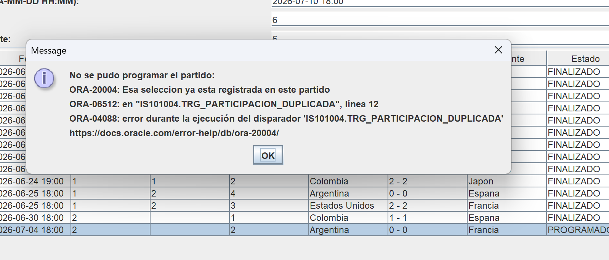
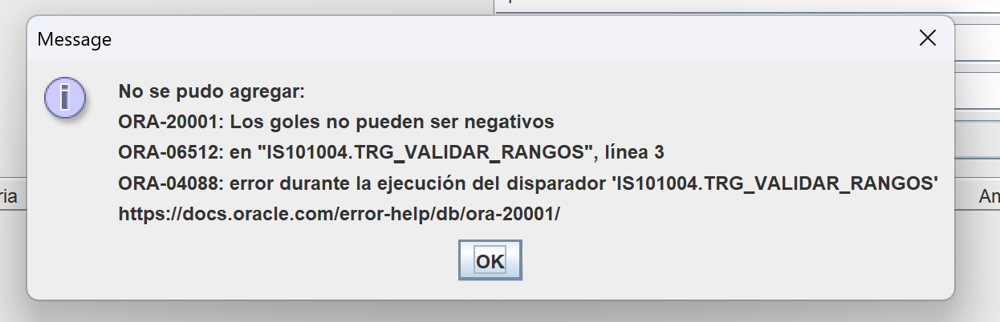
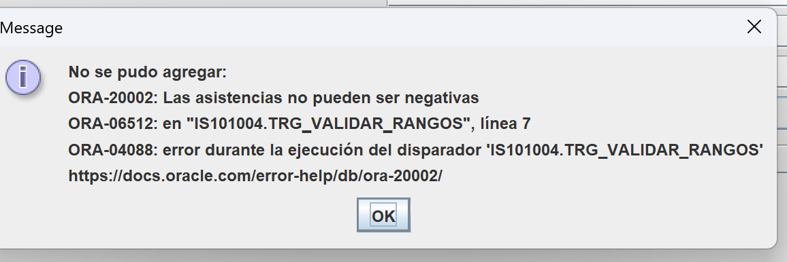
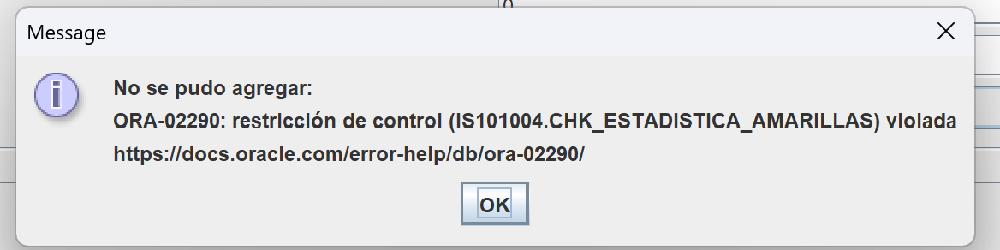
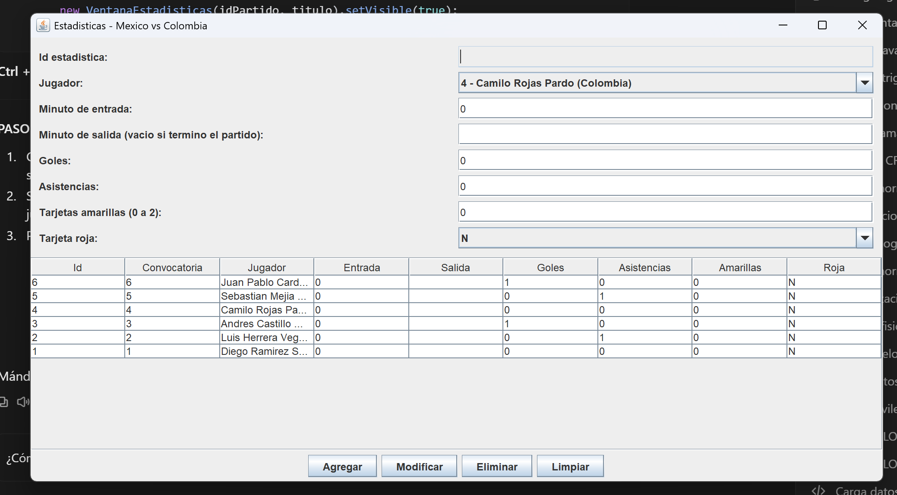
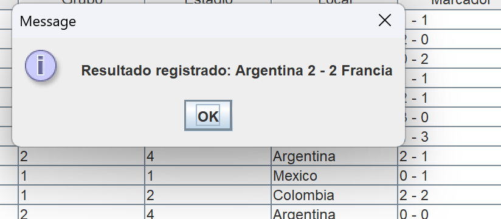

Pruebas de la aplicacion - Entrega 3

Aqui probamos que la aplicacion respeta las restricciones y los triggers de la base. Todo se hizo desde la aplicacion conectada a la base IS101004 con los datos de carga_datos_prueba.sql.

Para cada prueba ponemos que hicimos, lo que esperabamos y lo que salio.

1. Programar un partido con la misma seleccion de local y visitante

En Partidos llenamos los datos de un partido nuevo (fecha 2026-07-10 18:00) poniendo la seleccion 6 de local y tambien de visitante, y le dimos Programar.

Esperado: el trigger trg_participacion_duplicada no deja meter la segunda participacion (error -20004) y, como se hace en una transaccion, tampoco queda guardado el partido.

Obtenido: salio ORA-20004: Esa seleccion ya esta registrada en este partido. En la tabla de partidos no aparecio el partido nuevo, o sea que el rollback funciono.

2. Estadistica con goles negativos

En Estadisticas de un partido agregamos un jugador con goles = -1.

Esperado: ORA-20001 del trigger trg_validar_rangos.

Obtenido: ORA-20001: Los goles no pueden ser negativos.

3. Estadistica con asistencias negativas

Agregamos un jugador con asistencias = -2.

Esperado: ORA-20002 del trigger trg_validar_rangos.

Obtenido: ORA-20002: Las asistencias no pueden ser negativas.

4. Estadistica con 3 tarjetas amarillas

Agregamos un jugador con 3 amarillas.

Esperado: error del CHECK chk_estadistica_amarillas (solo se permite de 0 a 2).

Obtenido: ORA-02290: restriccion de control (IS101004.CHK_ESTADISTICA_AMARILLAS) violada.

5. Ver las estadisticas de un partido

Abrimos las estadisticas del partido Mexico vs Colombia.

Esperado: los 6 jugadores con sus goles y asistencias. Los goles tienen que cuadrar con el marcador 1 - 1.

Obtenido: salieron los 6 jugadores, Andres Castillo con 1 gol por Mexico y Juan Pablo Cardenas con 1 gol por Colombia.

6. Registrar el resultado de un partido

En Partidos programamos un partido nuevo (Argentina vs Francia, fase 2, estadio 2, 2026-07-04 18:00), lo seleccionamos y le dimos Registrar resultado con 2 - 2.

Esperado: la app llama al procedimiento pr_registrar_resultado y el partido queda FINALIZADO con ese marcador.

Obtenido: salio "Resultado registrado: Argentina 2 - 2 Francia" y en la tabla el partido quedo FINALIZADO 2 - 2. Despues lo borramos para dejar los datos como estaban.

