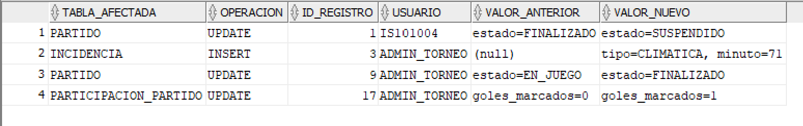

Pruebas de triggers - Entrega 3

Aqui nosotros vamos a probar que los 4 triggers obligatorios funcionan. Todo se corrio en SQL Developer con el usuario IS101004 y con los datos de carga_datos_prueba.sql.

igual que en las anteriores pruebas, en cada prueba ponemos lo que ejecutamos, lo que esperabamos y lo que salio.

1. Auditoria

Triggers: trg_auditoria_partido y trg_auditoria_estadistica

# Prueba 1.1 - Cambiar un partido

Cambiamos el estado del partido 1 y revisamos si quedo en la auditoria.

UPDATE partido SET estado = 'SUSPENDIDO' WHERE id_partido = 1;

SELECT tabla_afectada, operacion, id_registro, usuario, valor_anterior, valor_nuevo
FROM auditoria_evento
ORDER BY id_auditoria DESC;

ROLLBACK;

Esperado: un registro nuevo de PARTIDO, UPDATE, id 1, antes estado=FINALIZADO y despues estado=SUSPENDIDO.

Obtenido:

En l aimagen se evidencia que salio un registro nuevo en auditoria_evento: PARTIDO, UPDATE, id 1, usuario IS101004, antes estado=FINALIZADO y despues estado=SUSPENDIDO.

### Prueba 1.2 - Cambiar una estadistica

Le sumamos una asistencia a la estadistica 1.

UPDATE estadistica_jugador_partido SET asistencias = asistencias + 1 WHERE id_estadistica = 1;

SELECT tabla_afectada, operacion, id_registro, valor_anterior, valor_nuevo
FROM auditoria_evento
ORDER BY id_auditoria DESC;

ROLLBACK;

Esperado: un registro nuevo de ESTADISTICA_JUGADOR_PARTIDO, UPDATE, id 1, y las asistencias con 1 mas en el valor nuevo.

Obtenido:

---

## 2. Validacion de rangos

Triggers: trg_validar_rangos y trg_validar_rangos_marcador

### Prueba 2.1 - Goles negativos

UPDATE estadistica_jugador_partido SET goles = -1 WHERE id_estadistica = 1;

Esperado: ORA-20001: Los goles no pueden ser negativos

Obtenido:

### Prueba 2.2 - Asistencias negativas

UPDATE estadistica_jugador_partido SET asistencias = -2 WHERE id_estadistica = 1;

Esperado: ORA-20002: Las asistencias no pueden ser negativas

Obtenido:

### Prueba 2.3 - Marcador negativo

UPDATE participacion_partido SET goles_marcados = -1 WHERE id_participacion = 1;

Esperado: ORA-20003: El marcador no puede tener goles negativos

Obtenido:

---

## 3. Anti-duplicidad

Trigger: trg_participacion_duplicada

El partido 1 es Mexico vs Colombia, o sea que ya tiene sus dos selecciones. Mexico es la seleccion 1.

### Prueba 3.1 - Meter otra vez a Mexico en el mismo partido

INSERT INTO participacion_partido VALUES (99, 1, 1, 'LOCAL', 0, NULL, NULL);

Esperado: ORA-20004: Esa seleccion ya esta registrada en este partido

Obtenido:

### Prueba 3.2 - Meter una tercera seleccion

Japon (seleccion 3) no juega ese partido, pero el partido ya tiene dos.

INSERT INTO participacion_partido VALUES (99, 1, 3, 'LOCAL', 0, NULL, NULL);

Esperado: ORA-20005: El partido ya tiene sus dos selecciones

Obtenido:

---

## 4. Consistencia del marcador

Trigger: trg_consistencia_marcador

En el partido 1 Mexico hizo 1 gol y en las estadisticas sus jugadores tambien tienen 1 gol en total.

### Prueba 4.1 - Marcador que si cuadra

UPDATE partido SET estado = 'FINALIZADO' WHERE id_partido = 1;

ROLLBACK;

Esperado: 1 fila actualizada, sin error.

Obtenido:

### Prueba 4.2 - Marcador que no cuadra

Le ponemos 3 goles a Mexico, pero sus jugadores solo tienen 1, y despues finalizamos el partido.

UPDATE participacion_partido SET goles_marcados = 3 WHERE id_participacion = 1;

UPDATE partido SET estado = 'FINALIZADO' WHERE id_partido = 1;

ROLLBACK;

Esperado: ORA-20006: El marcador de la seleccion 1 (3) no coincide con los goles de sus jugadores (1)

Obtenido:

---

## Resumen

| Trigger | Pruebas | Funciona |
|---|---|---|
| Auditoria | 1.1 y 1.2 | |
| Validacion de rangos | 2.1, 2.2 y 2.3 | |
| Anti-duplicidad | 3.1 y 3.2 | |
| Consistencia del marcador | 4.1 y 4.2 | |
